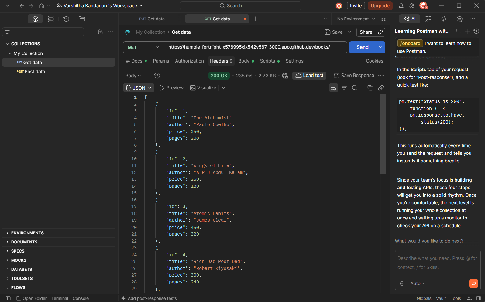
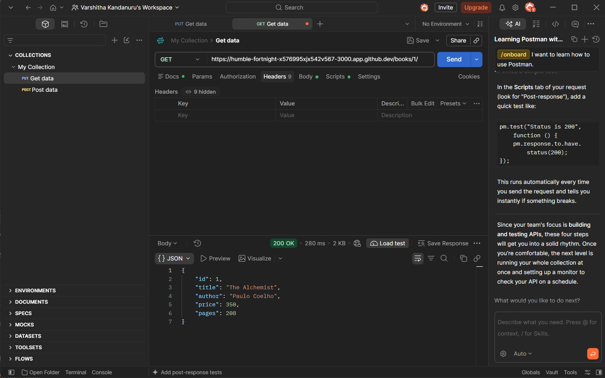
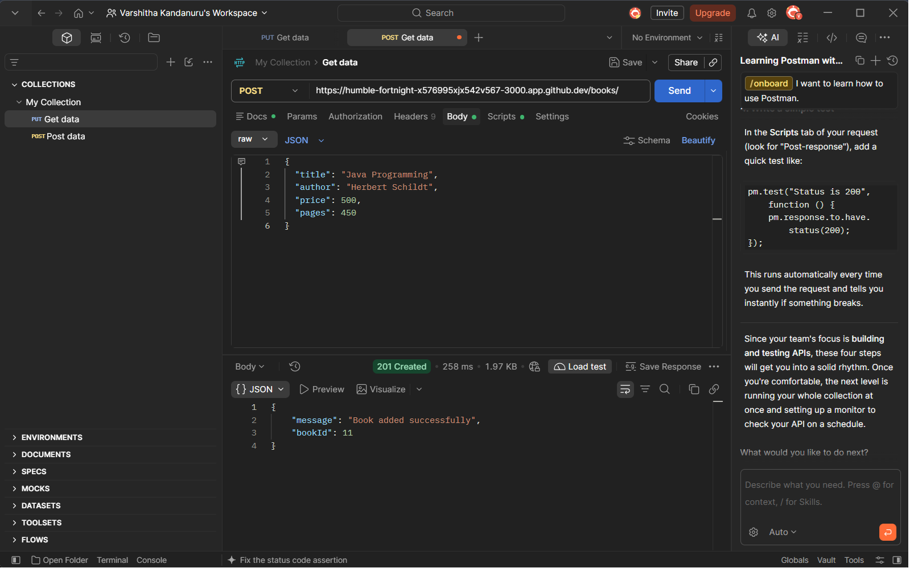
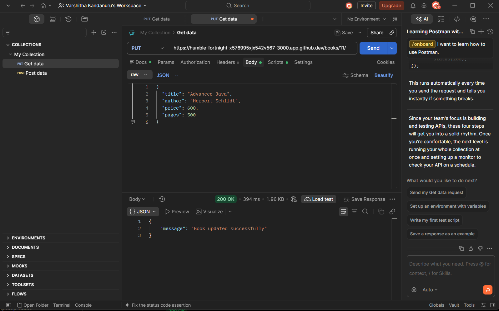
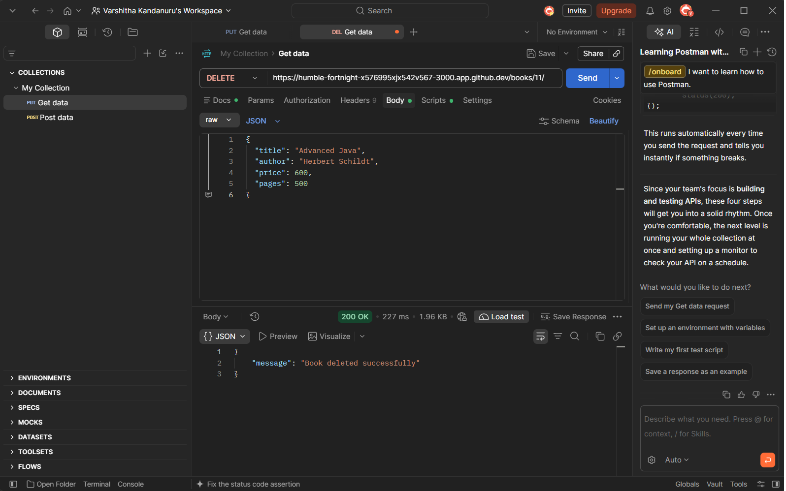
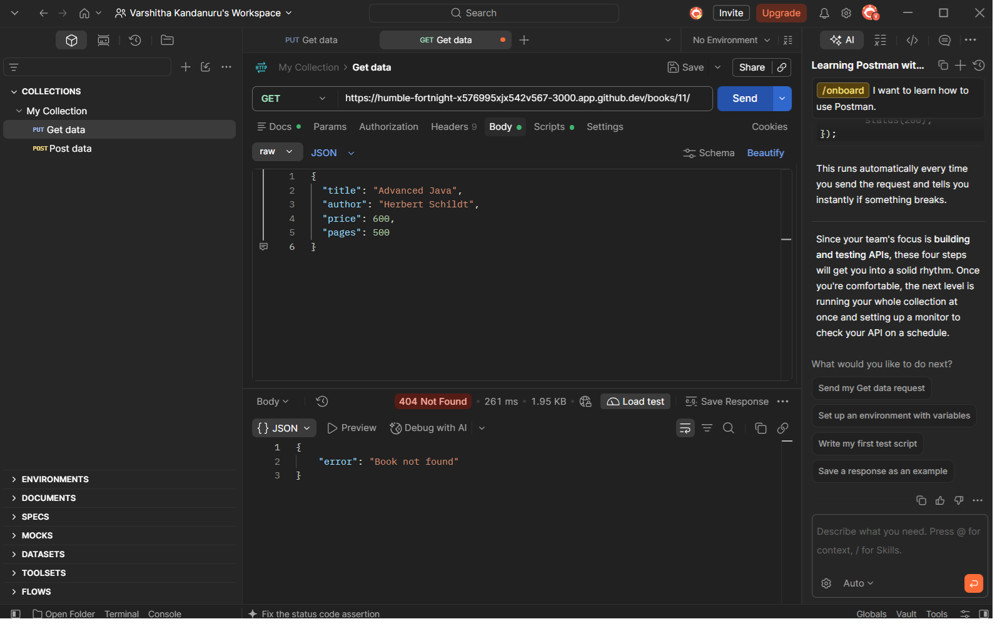

# Lab 2: SQLite Database and CRUD Routes

## Student Details

- **Name:** K. Varshitha
- **Registration Number:** 252U1R8038
- **Section:** 113 S-14

## Live Link

**Deployment:** Not deployed yet. The project is currently running in GitHub Codespaces. The Codespaces URL is temporary and is not a permanent deployment link.

## Project Description

This project connects an Express.js server with an SQLite database and implements CRUD operations to manage book records.

## Technologies Used

- Node.js
- Express.js
- SQLite
- SQLite3
- Nodemon
- Postman

## How to Run

### 1. Clone the repository

```bash
git clone YOUR_GITHUB_REPOSITORY_URL
```

### 2. Navigate to the project folder

```bash
cd lab-02
```

### 3. Install dependencies

```bash
npm install
```

### 4. Start the server

```bash
npm run dev
```

Server URL: `http://localhost:3000`

### Environment Variables

No environment variables are required for this project.

## Database Structure

**Database:** `books.db`

**Table:** `book`

| Column | Data Type |
|---|---|
| id | INTEGER PRIMARY KEY |
| title | TEXT |
| author | TEXT |
| price | INTEGER |
| pages | INTEGER |

The database contains 10 initial book records.

## API Endpoints

| Method | Endpoint | Description |
|---|---|---|
| GET | `/books/` | Retrieve all books |
| GET | `/books/:bookId/` | Retrieve a book by ID |
| POST | `/books/` | Add a new book |
| PUT | `/books/:bookId/` | Update an existing book |
| DELETE | `/books/:bookId/` | Delete a book |

## Screenshots

### 1. GET All Books



### 2. GET Single Book



### 3. POST - Add Book



### 4. PUT - Update Book



### 5. DELETE - Remove Book



### 6. DELETE Verification



## SQL Injection Prevention

All database queries that accept user input use parameterized queries with `?` placeholders to prevent SQL injection.

## Notes: Problems Faced and Solutions

1. Installed the required SQLite packages and configured Nodemon.
2. Connected the Express server to the SQLite database using async/await.
3. Configured Postman to send JSON request bodies.
4. Changed the GitHub Codespaces port visibility to Public for external API testing.
5. Verified POST, PUT and DELETE operations by checking the SQLite database.

## Conclusion

Successfully implemented all five CRUD API endpoints using Express.js and SQLite. Tested the endpoints using Postman and verified that database records are correctly inserted, updated and deleted.
## Deployment link 
https://lab-2-1-l4q8.onrender.com/
